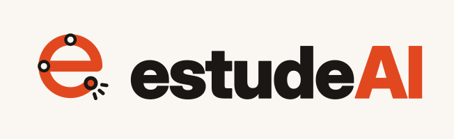

<p align="center">
  
</p>

Plataforma que monta um **roadmap de estudos personalizado** de Frontend, Backend, Fullstack ou DevOps. A pessoa responde a um diagnóstico rápido (objetivo, área, o que já sabe, tempo por semana e estilo de aprendizado), a API recorta uma trilha curada para ela, e depois ela acompanha o progresso e pode pedir um reajuste quando a rotina muda.

**NestJS · TypeORM · PostgreSQL · Gemini (`@google/genai`) · Next.js · TanStack Query · Zustand · pnpm workspaces**

## O que faz

- **Diagnóstico em etapas** (wizard) que define a área, o ritmo, o formato preferido de estudo e o que a pessoa já domina
- **Trilhas curadas no banco:** o conteúdo de cada área é revisado e versionado no repositório (`apps/api/src/tracks/content`), e não gerado a cada pedido
- **Recorte por pessoa, sem IA:** menos tempo por semana dá um roadmap mais enxuto, e os tópicos do que a pessoa já sabe entram concluídos
- **Projeto prático em cada módulo** e duração estimada em semanas, no ritmo que a pessoa informou
- **Justificativa escrita por IA** (Gemini), com um texto por regra de reserva: a geração nunca falha por erro de IA
- **Progresso por usuário:** marcar tópicos como concluídos e voltar depois
- **Reajuste dinâmico:** a IA reorganiza só o que falta, sem apagar o que já foi concluído
- **Recursos por tópico:** vídeos e playlists reais (YouTube Data API) e artigos, com os links validados antes de salvar e buscados em segundo plano por causa da cota

## Decisões técnicas

- **Conteúdo curado em vez de gerado:** a escolha da trilha e o recorte são regras fixas e testáveis (ver [`docs/TRILHAS.md`](docs/TRILHAS.md)). A IA fica onde agrega: a justificativa e o reajuste.
- **IA isolada em serviços próprios** (`TrackJustificationService`, `RoadmapAdjustService`): o controller nunca chama o Gemini diretamente, o que facilita trocar de provedor.
- **Contrato compartilhado** em `packages/shared-types`: web e API usam os mesmos DTOs, então uma mudança de payload quebra a compilação dos dois lados.
- **A geração não espera pelos recursos:** os links são buscados por uma fila em segundo plano, e os roadmaps criados antes recebem os links quando eles chegam.
- **Segurança:** JWT de acesso curto com refresh, rate limiting, Helmet e proteção contra poluição de parâmetros.

Os requisitos estão em [`REQUIREMENTS.md`](REQUIREMENTS.md) e a arquitetura em [`ARCHITETURE.md`](ARCHITETURE.md).

## Estrutura

```
apps/
  api/        NestJS: auth, tracks (catálogo de trilhas), roadmap (geração, reajuste, recursos), users
  web/        Next.js (App Router): login, wizard, dashboard, roadmap
packages/
  shared-types/   DTOs compartilhados entre web e api
```

## Como rodar

Pré-requisitos: Node 20+, pnpm e Docker.

```bash
pnpm install
docker compose up -d                       # PostgreSQL na porta 5432
cp apps/api/.env.example apps/api/.env     # preencha JWT_ACCESS_SECRET e GEMINI_API_KEY
pnpm dev                                   # API em :3001 e web em :3000
```

A `YOUTUBE_API_KEY` é opcional: sem ela o roadmap continua sendo gerado, só que sem os vídeos.

## Testes

```bash
pnpm --filter api test
```

Testes unitários dos serviços da API: escolha e recorte da trilha, conteúdo das trilhas, justificativa e reajuste com IA, progresso, descoberta de recursos e autenticação.

## Próximos passos

- Login social (Google ou GitHub)
- Testes E2E do fluxo do wizard no front
